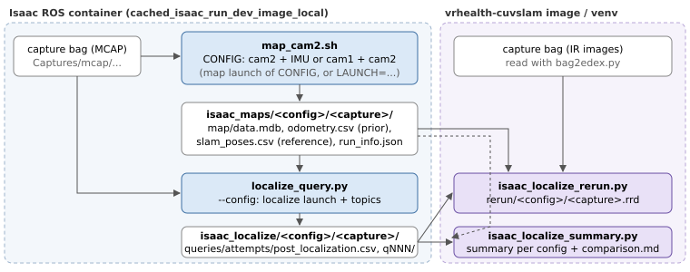

# VRHealth Challenge 13 - Isaac ROS relocalization tools

Reference documentation of the tools that measure **relocalization with Isaac ROS 5.0** (ROS 2 Lyrical,
`isaac_ros_cuvslam` 5.0.0, cuVSLAM 15.0.0+33da606) on the recorded D455 captures. Two input configurations, the same
as the two `slam_csv` folders, selected by `CONFIG` (`map_cam2.sh`) and `--config` (the Python scripts):

| Configuration | Cameras | cuVSLAM mode | Map / localize launch |
|---|---|---|---|
| `cam2_stereo_imu` (default) | cam2 IR stereo + cam2 IMU | `tracking_mode 1`, visual-inertial | `cuvslam_stereo_imu_cam2_map.launch.py` / `cuvslam_stereo_imu_cam2_localize.launch.py` |
| `cam1_cam2_stereo` | cam2 + cam1 IR stereo (4 images), no IMU | `tracking_mode 0`, multicamera, `sync_ms 35`, static TF `cam2_link -> cam1_link` | `cuvslam_stereo_cam1_cam2_map.launch.py` / `cuvslam_stereo_cam1_cam2_localize.launch.py` |

In both, rectified images and `base_frame cam2_link`: all poses (prior, reference, published) are `cam2_link` poses.
The default of every script is `cam2_stereo_imu`, which gives the same behaviour as before the configurations.

The tools simulate a **tracking loss**: a new Isaac ROS session is started on a cut of a capture and asked to localize
itself in a map saved earlier from the same capture, with a prior taken from the last pose known before the loss.

There are two steps:

1. one **mapping run** per capture (`map_cam2.sh`), which plays the bag in real time in Isaac ROS and saves the cuVSLAM
   map, the odometry (source of the prior) and the final SLAM trajectory (reference);
2. **relocalization queries** (`localize_query.py`), each in a new Isaac ROS session, on cuts of the same capture.

The results are then shown in Rerun (`isaac_localize_rerun.py`) and summarized over all the captures
(`isaac_localize_summary.py`).

The map, the prior (`odometry.csv`) and the reference (`slam_poses.csv`) all come from **the same mapping run**:
Isaac ROS in real time is not repeatable (two desktop runs of loop_closure differ by 2.7 m RMSE without alignment), so
mixing runs would add an error that has nothing to do with the localization.

The ROS node of `localize_query.py` is described in detail in `localize_query_node.md` / `localize_query_node.pdf`
(same folder). Results and analysis are in `~/dotlumen/localization/report_isaac_localization.md`.

## Contents

1. Overview
2. Containers and dependencies (folders per configuration)
3. Typical workflow
4. Script reference
   - map_cam2.sh
   - Launch files (cam2 map, map without IMU, localize; cam1 + cam2 map, localize)
   - localize_query.py
   - isaac_localize_rerun.py
   - isaac_localize_summary.py
5. File formats
6. Limits and notes

## Overview

| File | Folder | Type | What it does |
|---|---|---|---|
| `map_cam2.sh` | `isaac_ros_5/launch` | Bash | Mapping run: plays one or more captures at real-time speed in Isaac ROS, saves the map (`visual_slam/save_map`), records the output topics and extracts the trajectories |
| `cuvslam_stereo_imu_cam2_map.launch.py` | `isaac_ros_5/launch` | ROS 2 launch | Node parameters of the mapping run (stereo + IMU) |
| `cuvslam_stereo_cam2_map_noimu.launch.py` | `isaac_ros_5/launch` | ROS 2 launch | Mapping run without IMU (`tracking_mode 0`), for diagnostics |
| `cuvslam_stereo_imu_cam2_localize.launch.py` | `isaac_ros_5/launch` | ROS 2 launch | Node parameters of the relocalization queries (adds the localizer search grid) |
| `cuvslam_stereo_cam1_cam2_map.launch.py` | `isaac_ros_5/launch` | ROS 2 launch | Mapping run of `cam1_cam2_stereo` (multicamera, no IMU) |
| `cuvslam_stereo_cam1_cam2_localize.launch.py` | `isaac_ros_5/launch` | ROS 2 launch | Relocalization queries of `cam1_cam2_stereo` (adds the localizer search grid) |
| `localize_query.py` | `isaac_ros_5/launch` | Python (rclpy) | Relocalization queries with `visual_slam/localize_in_map`, one new Isaac ROS session per query; metrics from the recorded query bags |
| `isaac_localize_rerun.py` | `scripts` | Python | Rerun recording of the queries of one capture (map, prior, attempts, logged and published poses, overview of all the results) |
| `isaac_localize_summary.py` | `scripts` | Python | `summary.md` / `summary.csv` of the queries of all the captures, per configuration, and `comparison.md` / `comparison.csv` between the configurations |



Existing files used but **not modified**: `extract_paths.py` (called by `map_cam2.sh`), `slam_cam2.sh` and
`slam_cam1_cam2.sh` (models of `map_cam2.sh`), `cuvslam_stereo_imu_cam2.launch.py` and
`cuvslam_stereo_cam1_cam2.launch.py` (models of the new launch files) and, in `scripts/`, `bag2edex.py` (imported by
`isaac_localize_rerun.py`) and `docker/run.sh`.

## Containers and dependencies

| Tool | Where it runs | Needs |
|---|---|---|
| `map_cam2.sh` | host (one throwaway container per capture) or inside an Isaac ROS container (`IN_CONTAINER=1`) | Docker with the NVIDIA runtime, image `cached_isaac_run_dev_image_local` (ROS 2 Lyrical, `isaac_ros_cuvslam` 5.0.0); `extract_paths.py` in the same folder |
| launch files | Isaac ROS container | `isaac_ros_cuvslam`, `rclcpp_components` |
| `localize_query.py` | Isaac ROS container, ROS sourced | `rclpy`, `rosbag2_py`, `tf2_ros`, `isaac_ros_visual_slam_interfaces`, `numpy`, `yaml` (all in the image); the localize launch file in the same folder |
| `isaac_localize_rerun.py` | host venv or the `vrhealth-cuvslam` image (`scripts/docker/run.sh`) | `rerun-sdk` 0.33, `numpy`, `bag2edex.py` (same folder, with its dependencies `zstandard`/`lz4` for compressed bags) |
| `isaac_localize_summary.py` | anywhere | Python standard library only |

Folder conventions:

- the data folder `~/dotlumen` is mounted at `/workspaces/isaac_ros-dev` in the Isaac ROS container; paths given to
  `map_cam2.sh` and to `localize_query.py` (when run with `-w /workspaces/isaac_ros-dev`) are relative to it;
- maps: `~/dotlumen/localization/isaac_maps/<config>/<capture>/`;
- queries: `~/dotlumen/localization/isaac_localize/<config>/<capture>/` (summary in
  `isaac_localize/<config>/summary.{md,csv}`, comparison of the configurations in `isaac_localize/comparison.{md,csv}`);
- Rerun recordings: `~/dotlumen/localization/rerun/<config>/<capture>.rrd`;
- extra cam2 runs: `isaac_maps/cam2_stereo_imu/staircases_fix_1_{v2,v3,noimu}` (diagnostics),
  `isaac_maps_repeat/cam2_stereo_imu/loop_closure` (repeatability), `isaac_localize/cam2_stereo_imu/loop_closure_{test,verbose,verbose2}`.

`<config>` is `cam2_stereo_imu` or `cam1_cam2_stereo`. The results of the cam2 stereo + IMU analysis made before the
configurations (flat folders) were moved into `cam2_stereo_imu/`; the `map_run` of their `localize_info.json` was
updated.

Use the MCAP bags of `Captures/mcap`: the db3 copies in `lyrical/workspaces/isaac_ros-dev/bags` have a
`metadata.yaml` that names a file that does not exist (`loop_closure_0.db3` instead of `loop_closure_0-001.db3`).

## Typical workflow

```bash
# CONFIG=cam2_stereo_imu (default) or cam1_cam2_stereo; the same value in every step
CONFIG=cam1_cam2_stereo

# 1. maps (host): one container per capture, ~1 min per capture -> localization/isaac_maps/$CONFIG/<capture>
cd ~/dotlumen/VRHealth_Challenge13/isaac_ros_5/launch
CONFIG=$CONFIG ./map_cam2.sh loop_closure=Captures/mcap/9_Loop_closure/loop_closure

# 2. queries of one capture (host): 36 queries x ~17 s on loop_closure -> localization/isaac_localize/$CONFIG/<capture>
docker run --rm --gpus all --ipc=host --user $(id -u):$(id -g) -e HOME=/tmp -e ROS_LOG_DIR=/tmp/roslog \
  -v ~/dotlumen:/workspaces/isaac_ros-dev -w /workspaces/isaac_ros-dev cached_isaac_run_dev_image_local \
  bash -c "source /opt/ros/lyrical/setup.bash; python3 VRHealth_Challenge13/isaac_ros_5/launch/localize_query.py \
   --config $CONFIG --capture loop_closure --bag Captures/mcap/9_Loop_closure/loop_closure"
   # outdoor_b_2000: add --duration 5

# 3. Rerun recording of the queries (scripts folder, vrhealth-cuvslam image) -> localization/rerun/$CONFIG/<capture>.rrd
cd ~/dotlumen/VRHealth_Challenge13/scripts
NO_X11=1 docker/run.sh python3 isaac_localize_rerun.py --config $CONFIG --capture loop_closure \
  --bag ~/dotlumen/Captures/mcap/9_Loop_closure/loop_closure --image-every 5
rerun ~/dotlumen/localization/rerun/$CONFIG/loop_closure.rrd

# 4. summary of all the captures, per configuration, and comparison between the configurations
python3 isaac_localize_summary.py
```

`--capture` only sets the default paths (`--map-run localization/isaac_maps/<config>/<capture>`, `--out-dir
localization/isaac_localize/<config>/<capture>`, and the same under `~/dotlumen/localization` for the Rerun script);
explicit `--map-run` / `--out-dir` / `--localize` / `--save` still work as before.

Wall times on the desktop (RTX 4070 Ti): maps about 1 minute per capture; queries about 16.5 s each (192 queries of
11 captures in about 55 minutes per configuration); Rerun recordings about 1 minute in total (a few minutes with the
cam1 images); summary under a second.

# Script reference

## map_cam2.sh

Runs Isaac ROS cuVSLAM on one or more bags at real-time speed, records the output topics and **saves the cuVSLAM map**
of each run with the `visual_slam/save_map` service. The input configuration is selected by `CONFIG`: `cam2_stereo_imu`
(default, cam2 IR stereo + IMU) or `cam1_cam2_stereo` (cam2 + cam1 IR stereo, multicamera, no IMU). It is modeled on
`slam_cam2.sh` and `slam_cam1_cam2.sh`, which are not modified.

**How it works**

The script has two modes, selected by `IN_CONTAINER`:

- **host mode** (default): for each `<capture>=<bag>` argument it starts a throwaway container
  (`docker run --rm --gpus all --ipc=host`, host user, `HOME=/tmp`, `ROS_LOG_DIR=/tmp/roslog`, data folder mounted at
  `/workspaces/isaac_ros-dev`) that runs the same script with `IN_CONTAINER=1` on that single capture. Each container
  gets a random `ROS_DOMAIN_ID` between 100 and 199, so that runs do not see each other's topics. The script must be
  inside the data folder (it is called through its path in the container).
- **container mode** (`IN_CONTAINER=1`): sources `/opt/ros/*/setup.bash` and processes the captures one after the other.

For each capture, in container mode:

1. If `<OUT_ROOT>/<capture>/done` exists and `FORCE` is not 1, the capture is skipped. Otherwise the output folder is
   deleted and recreated.
2. `ros2 launch $LAUNCH` (default: `cuvslam_stereo_imu_cam2_map.launch.py` for `cam2_stereo_imu`,
   `cuvslam_stereo_cam1_cam2_map.launch.py` for `cam1_cam2_stereo`) in its own process group; waits up to 60 s
   for `visual_slam_node` in `ros2 node list`, then 3 s more.
3. `ros2 bag record -s mcap` of `/visual_slam/tracking/{odometry,vo_path,slam_path}`, `/visual_slam/status`, `/tf`,
   `/tf_static`; 3 s wait and check that the recorder is alive.
4. `ros2 bag play` of the whole capture at rate 1.0, with `/cam2/infra{1,2}/image_rect_raw`,
   `/cam2/infra{1,2}/camera_info` and `/tf_static`, plus `/cam2/imu` (`cam2_stereo_imu`) or
   `/cam1/infra{1,2}/image_rect_raw` and `/cam1/infra{1,2}/camera_info` (`cam1_cam2_stereo`, no IMU; the TF
   `cam2_link -> cam1_link`, missing in the bags, is published by the launch).
5. After `SETTLE_S` seconds: `ros2 service call /visual_slam/save_map isaac_ros_visual_slam_interfaces/srv/FilePath
   "{file_path: '<out>/map'}"`. The call is considered successful if its answer contains `success=True`.
6. Stops the recorder and the node (SIGINT, SIGTERM after 5 s, SIGKILL after 30 s, on the whole process group).
7. `extract_paths.py --bag <out>/bag <out>` → `odometry.csv`, `vo_path.csv`, `slam_poses.csv`, `status.csv` (same
   format as `slam_csv`).
8. Writes `run_info.json` (versions read from the image: `ros2 pkg xml isaac_ros_cuvslam --tag version` and the
   cuVSLAM version string inside `libcuvslam.so`).
9. Writes the `done` marker only if `save_map` succeeded, `map/data.mdb` exists and `slam_poses.csv` was extracted;
   otherwise prints an error and goes on with the next capture.

**Usage**

```bash
cd ~/dotlumen/VRHealth_Challenge13/isaac_ros_5/launch
./map_cam2.sh loop_closure=Captures/mcap/9_Loop_closure/loop_closure      # cam2_stereo_imu
CONFIG=cam1_cam2_stereo ./map_cam2.sh loop_closure=Captures/mcap/9_Loop_closure/loop_closure
./map_cam2.sh staircases_up_109=Captures/mcap/3_Staircases/staircases_up_109 low_detail=Captures/mcap/10_Low_feature/low_detail
# redo a capture already done
FORCE=1 ./map_cam2.sh loop_closure=Captures/mcap/9_Loop_closure/loop_closure
# another launch file (path as seen inside the container), e.g. without IMU, under another output name
# (with the default CONFIG the output is localization/isaac_maps/cam2_stereo_imu/staircases_fix_1_noimu)
LAUNCH=/workspaces/isaac_ros-dev/VRHealth_Challenge13/isaac_ros_5/launch/cuvslam_stereo_cam2_map_noimu.launch.py \
    ./map_cam2.sh staircases_fix_1_noimu=Captures/mcap/3_Staircases/staircases_fix_1
# inside a container that already has ROS 2 + isaac_ros_cuvslam
IN_CONTAINER=1 ./map_cam2.sh loop_closure=Captures/mcap/9_Loop_closure/loop_closure
```

**Arguments and environment variables**

| Argument / variable | Value | Default | Description |
|---|---|---|---|
| `<capture>=<bag>` (positional, one or more) | text | **required** | output name and bag path, relative to the data folder |
| `CONFIG` | `cam2_stereo_imu` \| `cam1_cam2_stereo` | `cam2_stereo_imu` | input configuration: launch file, played topics, output folder |
| `IMAGE` | text | `cached_isaac_run_dev_image_local` | Docker image (host mode) |
| `DATA` | path | `$HOME/dotlumen` | data folder, mounted at `/workspaces/isaac_ros-dev`; the script must be inside it |
| `OUT_ROOT` | path | `localization/isaac_maps/<CONFIG>` | output folder, relative to the data folder |
| `SETTLE_S` | number | `5` | seconds after the end of the playback before saving the map |
| `FORCE` | `0` \| `1` | `0` | `1` = redo the captures already done (`done` file) |
| `LAUNCH` | path | map launch of `CONFIG` (next to the script) | launch file, as seen inside the container |
| `IN_CONTAINER` | `0` \| `1` | `0` | `1` = run directly in the current container (ROS 2 and `isaac_ros_cuvslam` needed) |

The exit code in host mode is the code of the last container that failed (0 if all succeeded). Errors of single
captures are printed and do not stop the loop.

**Output** (`<OUT_ROOT>/<capture>/`, default `localization/isaac_maps/<CONFIG>/<capture>/`)

| File | Content |
|---|---|
| `map/data.mdb` | cuVSLAM map saved by Isaac ROS (LMDB), input of `localize_query.py` |
| `bag/` | MCAP recording of the output topics |
| `odometry.csv`, `vo_path.csv`, `slam_poses.csv`, `status.csv` | trajectories of the run, extracted with `extract_paths.py`: `timestamp,x,y,z,qx,qy,qz,qw,roll_deg,pitch_deg,yaw_deg`, poses of `cam2_link`, header stamps in seconds. `odometry.csv` is the source of the prior; `slam_poses.csv` (last `slam_path`, after loop closures) is the reference of the queries |
| `run_info.json` | script, configuration (`config`), capture, bag, launch, image, ROS distro, `isaac_ros_cuvslam` and cuVSLAM versions, played and recorded topics, play return code and duration, settle time, `save_map` return code / success / duration, map folder and size (MB), extraction summary, total time |
| `launch.log`, `record.log`, `play.log`, `save_map.log`, `extract.log` | logs of the steps |
| `done` | marker of a complete run |

On the desktop: play = length of the capture (17–59 s), `save_map` about 1 s, total about 1 minute per capture; maps of
16–103 MB with `cam2_stereo_imu` (loop_closure: 799 poses, 102.6 MB, 81 s in total) and 15–157 MB with
`cam1_cam2_stereo` (loop_closure: 704 poses, 157.0 MB: two cameras of landmarks, fewer frames because of the 35 ms
sync).

**Limits**

- One real-time run: the map and the trajectories change from run to run (see the introduction). Keep map, prior and
  reference of the same run together.
- The map contains whatever the run produced: on `staircases_fix_1` every stereo + IMU run of Isaac ROS 5.0 diverges at
  20–22 s, so map and reference of that capture are wrong (flagged as not reliable in the summary; the stereo-only map
  `staircases_fix_1_noimu` was made with `LAUNCH=..._map_noimu.launch.py` for this diagnosis). The
  `cam1_cam2_stereo` runs do not diverge on this capture (23.1 m, Jetson 23.9 m).
- `cam1_cam2_stereo`: cam1 and cam2 are not hardware synchronized; frames whose cam1 and cam2 images are more than
  35 ms apart are dropped by the node (0–23 % depending on the capture), and the gaps above 150 ms are logged as
  "Delta between current and previous frame" warnings in `launch.log`.
- `save_map` is called only once, at the end; if the node crashes during the playback there is no map (the capture is
  not marked `done`).

## Launch files

### cam2 stereo + IMU (`cam2_stereo_imu`)

Three new launch files, all copies of `cuvslam_stereo_imu_cam2.launch.py` (the launch of the `slam_csv` runs, not
modified). They start `visual_slam_node` (`isaac_ros_cuvslam`, plugin `nvidia::isaac_ros::visual_slam::VisualSlamNode`)
in a `component_container_mt`, with the same remappings (`/cam2/infra1` = left = `image_0`, `/cam2/infra2` = right =
`image_1`, `/cam2/imu`) and the same parameters, except for the differences below.

| Parameter | slam_csv launch | `..._imu_cam2_map` | `..._cam2_map_noimu` | `..._imu_cam2_localize` |
|---|---|---|---|---|
| `tracking_mode` | 1 (stereo + IMU) | 1 | **0** (stereo only) | 1 |
| `enable_slam_visualization`, `enable_landmarks_view`, `enable_observations_view` | True | **False** | **False** | **False** |
| `slam_max_map_size` | default (300 poses) | **100000** | **100000** | **100000** |
| `verbosity` | default | default | default | **1** |
| `localizer_horizontal_radius` | default (1.5 m) | default | default | **4.0** m |
| `localizer_vertical_radius` | default (0.5 m) | default | default | **1.0** m |
| `localizer_horizontal_step` | default (0.5 m) | default | default | **0.5** m |
| `localizer_vertical_step` | default (0.25 m) | default | default | **0.25** m |
| `localizer_angular_step` | default (0.1745 rad) | default | default | **0.1745** rad (10 deg) |

Common parameters: `rectified_images: True`, `base_frame: cam2_link`, `imu_frame: cam2_gyro_optical_frame`, IMU noise
`gyro_noise_density 0.000244`, `gyro_random_walk 0.000019393`, `accel_noise_density 0.001862`,
`accel_random_walk 0.003`, `calibration_frequency 200`, `image_jitter_threshold_ms 150`, ground constraints off,
`enable_localization_n_mapping: True` (required by `save_map` and `localize_in_map`), `enable_image_denoising: False`,
`num_cameras 2`, `min_num_images 2`.

| File | Used by | Purpose |
|---|---|---|
| `cuvslam_stereo_imu_cam2_map.launch.py` | `map_cam2.sh` (default) | mapping run: the whole capture stays in the saved map (`slam_max_map_size` large; with the default of 300 poses the map would keep only the last 300 poses), visualization off to keep the load low during the real-time run |
| `cuvslam_stereo_cam2_map_noimu.launch.py` | `map_cam2.sh` with `LAUNCH=...` | same as the map launch without IMU fusion; diagnostic of the diverging stereo + IMU runs of `staircases_fix_1` |
| `cuvslam_stereo_imu_cam2_localize.launch.py` | `localize_query.py` (default `--launch`) | relocalization queries: the localizer search grid of `map_bag.py localize` (radius 4 m horizontal, 1 m vertical, steps 0.5 / 0.25 m, 10 deg) |

Notes:

- The localizer grid parameters are read by the node at start-up and used for every `localize_in_map` request. The grid
  is centered on the prior: horizontal on the rig x/z plane of cuVSLAM, vertical along rig y, with a full 360 deg
  rotation around the vertical axis; candidates are tried starting from the closest one to the prior. Maximum number of
  candidates with these values: 17² × 9 × 36 = 93636.
- The docstring of the localize launch file says "verbosity 3", but the file sets `verbosity: 1`. Verbosity 3 only adds
  "Lost IMU msgs" warnings, because `libcuvslam.so` in the image is built without the SLAM debug output.
- The map launch files do not set `save_map_folder_path`: the map is saved explicitly by `map_cam2.sh` with the service.

### cam1 + cam2 stereo, multicamera (`cam1_cam2_stereo`)

Two new launch files, copies of `cuvslam_stereo_cam1_cam2.launch.py` (the launch of the `slam_csv/cam1_cam2_stereo`
runs, not modified), with the same changes as the cam2 ones. They start the same `visual_slam_node` with 4 cameras and a
`static_transform_publisher` for `cam2_link -> cam1_link` (x −13.4 mm, z −63.4 mm from the holder CAD, pitch +49.3 deg
= 0.8604 rad from the gyros), which the bags do not contain. Remappings: `/cam2/infra1` = `image_0`, `/cam2/infra2` =
`image_1`, `/cam1/infra1` = `image_2`, `/cam1/infra2` = `image_3` (with their `camera_info_<n>`); optical frames
`cam2_infra{1,2}_optical_frame`, `cam1_infra{1,2}_optical_frame`. Launch argument `sync_ms` (default 35).

| Parameter | slam_csv launch (`cuvslam_stereo_cam1_cam2`) | `..._cam1_cam2_map` | `..._cam1_cam2_localize` |
|---|---|---|---|
| `tracking_mode` | 0 (multicamera, no IMU) | 0 | 0 |
| `num_cameras`, `min_num_images` | 4, 4 | 4, 4 | 4, 4 |
| `sync_matching_threshold_ms` | `sync_ms` = 35 | 35 | 35 |
| `enable_slam_visualization`, `enable_landmarks_view`, `enable_observations_view` | True | **False** | **False** |
| `slam_max_map_size` | default (300 poses) | **100000** | **100000** |
| `verbosity` | default | default | **1** |
| `localizer_*` (grid) | default | default | **4.0 / 1.0 / 0.5 / 0.25 m, 0.1745 rad** (same as the cam2 localize launch) |

Common parameters: `rectified_images: True`, `base_frame: cam2_link`, `image_jitter_threshold_ms 150`, ground
constraints off, `enable_localization_n_mapping: True`, `enable_image_denoising: False`; no IMU parameters.

| File | Used by | Purpose |
|---|---|---|
| `cuvslam_stereo_cam1_cam2_map.launch.py` | `map_cam2.sh` with `CONFIG=cam1_cam2_stereo` | mapping run of the multicamera configuration |
| `cuvslam_stereo_cam1_cam2_localize.launch.py` | `localize_query.py --config cam1_cam2_stereo` | relocalization queries of the multicamera configuration |

`localize_in_map` works with the multicamera rig: the node logs `Tracking mode: Multicamera` and localizes with the
same `Successfully localized at {x, y, z}` / `Failed to localize in map` messages and `map->odom` updates as with cam2.

## localize_query.py

Runs relocalization queries with Isaac ROS: for every pair (t1, t_prev) it starts a **new** Isaac ROS session, plays the
cut [t1, t1 + duration] of the capture at real-time speed and calls the `visual_slam/localize_in_map` service with a
prior computed from the last pose known before a simulated loss of `t_prev` seconds. It runs inside the Isaac ROS
container. The design of the node (interfaces, state machine, timing, evaluation) is described in detail in
`localize_query_node.md`.

**Configuration** (`--config`): selects the launch file of the new session and the topics played from the bag.

| `--config` | Launch (default `--launch`) | Played topics |
|---|---|---|
| `cam2_stereo_imu` (default) | `cuvslam_stereo_imu_cam2_localize.launch.py` | `/cam2/infra{1,2}/image_rect_raw`, `/cam2/infra{1,2}/camera_info`, `/cam2/imu` |
| `cam1_cam2_stereo` | `cuvslam_stereo_cam1_cam2_localize.launch.py` | the cam2 IR topics and `/cam1/infra{1,2}/image_rect_raw`, `/cam1/infra{1,2}/camera_info` (no IMU) |

The map (`--map-run`) must come from `map_cam2.sh` with the same configuration. `--g-map` needs the IMU and is refused
with `cam1_cam2_stereo`.

**Frame stamps with `cam1_cam2_stereo`**: Isaac ROS stamps each multicamera frame with the header of the cam1 image
or of the cam2 image, and the choice changes from run to run (e.g. build_out_in: mapping run 388 cam1 / 207 cam2
stamps, queries all cam2). Frames of a query and of the mapping run can therefore be one cam1–cam2 offset apart
(7.8–15.4 ms on the 30 Hz captures, up to ~33 ms), so with this configuration the reference is interpolated
(`--ref-interp-ms 200`) instead of requiring a pose within 2 ms. The remaining ambiguity is the motion during the
cam1–cam2 offset (a few cm at walking speed). `isaac_localize_rerun.py` uses the same rule.

**How it works** (for each query)

1. Starts `ros2 launch <--launch>`: a new `visual_slam_node`, with no map loaded, in its own process group.
2. Creates the rclpy node `QueryNode`, waits up to 60 s for the `localize_in_map` service, republishes the `/tf_static`
   of the bag (latched, `TRANSIENT_LOCAL`: the cut starts after the static messages of the bag).
3. Starts `ros2 bag record -s mcap` of `/visual_slam/tracking/odometry`, `/visual_slam/tracking/slam_path`,
   `/visual_slam/status`, `/tf`, `/rosout` into `q<NNN>/bag`; after 2 s starts `ros2 bag play` of the topics of the
   configuration (table above) with `--start-offset t1 − 0.1` and `--playback-duration duration + 0.1`.
4. Prior of attempt k: `prior_k = T_last · O_first⁻¹ · O_k`, with `T_last` the last pose of the mapping
   `odometry.csv` with timestamp ≤ t1 − t_prev, `O_first` the first odometry pose of the new session, `O_k` the odometry
   pose of the frame of the attempt.
5. The first attempt is made at the first odometry message; the service answers immediately ("started"), the result is
   read from the log of `visual_slam_node` on `/rosout` (`Successfully localized at {x, y, z}` or
   `Failed to localize in map ...` / `Cannot localize ...`). On failure, a new attempt at the first frame at least
   `--attempt-every` s (bag time) after the previous call, up to `--attempts`.
6. The playback continues until t2 in every case; then `--settle` s of spinning, and the three processes are stopped.
7. The metrics are computed from the recorded query bag (`evaluate_bag`): localized frame, settled `map->odom`,
   logged-position error (localizer metric), published-pose error (published metric), errors at +1 s / +2 s, errors
   from the settled frame to t2. All errors are against `slam_poses.csv` of the mapping run, in the map frame,
   `cam2_link` poses, without alignment.

**Sampling of the queries**

When `--t1` is not given, t1 goes from `max(margin, start of the reference + max(t_prev) + margin)` to
`end of the reference − duration`, in steps of `--t1-step` (same rule as `map_bag.py localize`), in seconds from the
start of the bag. Each t1 is combined with every `--t-prev`: on loop_closure, 9 values of t1 (6.97 … 46.97 s) × 4 t_prev
= 36 queries. Queries are numbered from 1 in that order (t1 outer loop, t_prev inner loop).

**Usage** (inside the Isaac ROS container, ROS sourced; paths relative to `/workspaces/isaac_ros-dev`)

```bash
# all the default queries of a capture, cam2 stereo + IMU (default paths from --config and --capture)
python3 VRHealth_Challenge13/isaac_ros_5/launch/localize_query.py --capture loop_closure \
    --bag Captures/mcap/9_Loop_closure/loop_closure
# the same with explicit paths
python3 VRHealth_Challenge13/isaac_ros_5/launch/localize_query.py \
    --bag Captures/mcap/9_Loop_closure/loop_closure --map-run localization/isaac_maps/cam2_stereo_imu/loop_closure \
    --out-dir localization/isaac_localize/cam2_stereo_imu/loop_closure
# cam1 + cam2 stereo
python3 VRHealth_Challenge13/isaac_ros_5/launch/localize_query.py --config cam1_cam2_stereo --capture loop_closure \
    --bag Captures/mcap/9_Loop_closure/loop_closure
# short test: 1 cut x 2 t_prev = 2 queries
python3 VRHealth_Challenge13/isaac_ros_5/launch/localize_query.py --config cam1_cam2_stereo \
    --bag Captures/mcap/9_Loop_closure/loop_closure --map-run localization/isaac_maps/cam1_cam2_stereo/loop_closure \
    --out-dir localization/isaac_localize/cam1_cam2_stereo/loop_closure_test --t1 20 --t-prev 0 3
# recompute the metrics of an existing run from its recorded bags (no new query)
python3 VRHealth_Challenge13/isaac_ros_5/launch/localize_query.py --capture loop_closure \
    --bag Captures/mcap/9_Loop_closure/loop_closure --reevaluate
```

From the host, wrap the command in `docker run ... cached_isaac_run_dev_image_local bash -c 'source
/opt/ros/lyrical/setup.bash; python3 ...'` as in the typical workflow above.

**Arguments and options**

| Argument | Value | Default | Description |
|---|---|---|---|
| `--config` | `cam2_stereo_imu` \| `cam1_cam2_stereo` | `cam2_stereo_imu` | input configuration: launch, played topics, default paths |
| `--bag` | path | **required** | capture bag (MCAP or db3 folder with `metadata.yaml`); must be the capture of the map |
| `--capture` | text | - | capture name, used only for the default `--map-run` / `--out-dir` |
| `--map-run` | path | `localization/isaac_maps/<config>/<capture>` | folder of `map_cam2.sh`: `map/`, `odometry.csv` (prior), `slam_poses.csv` (reference); required without `--capture` |
| `--out-dir` | path | `localization/isaac_localize/<config>/<capture>` | output folder (created); required without `--capture` |
| `--launch` | path | localize launch of `--config`, next to the script | launch file of the new session |
| `--t1` | one or more numbers | sampled with `--t1-step` | start times of the cuts (s from the start of the bag) |
| `--t1-step` | number | `5.0` | sampling step of t1 (s) |
| `--margin` | number | `2.0` | t1 − max(t_prev) at least this many seconds after the start of the reference (sampling only) |
| `--duration` | number | `10.0` | length of each cut t2 − t1 (s); 5 s was used for outdoor_b_2000 (17 s capture) |
| `--t-prev` | one or more numbers | `0 1 3 5` | simulated loss: `T_last` = last mapping odometry pose at t1 − t_prev |
| `--attempts` | integer | `16` | maximum number of `localize_in_map` calls per query (N) |
| `--attempt-every` | number | `0.25` | minimum bag time between two calls (s); a new call waits for the result of the previous one |
| `--settle` | number | `3.0` | seconds of spinning after the end of the cut (last messages, pending result) |
| `--thr-t` | number | `0.3` | true positive threshold, translation (m), both metrics |
| `--thr-r` | number | `10.0` | true positive threshold, rotation (deg), published metric only |
| `--g-map` | `X` `Y` `Z` | off | gravity direction in the map frame: enables the accelerometer roll/pitch correction of the prior (not used in the results; `cam2_stereo_imu` only) |
| `--imu-window` | number | `0.5` | accelerometer averaging window for `--g-map` (s) |
| `--stall-timeout` | number | `10.0` | stop the query after N s of wall time without odometry |
| `--ref-interp-ms` | number | `0` (`cam2_stereo_imu`), `200` (`cam1_cam2_stereo`) | reference lookup: when no reference pose is within 2 ms of a frame, interpolate (linear position, slerp) between the two reference poses around it if they are at most this many ms apart; 0 = off |
| `--reevaluate` | flag | off | do not run queries: recompute the localization metrics, and the prior errors of queries and attempts, of an existing `--out-dir` from its `q<NNN>/bag` |

**Output** (`--out-dir`)

| File | Content |
|---|---|
| `queries.csv` | one row per query: t1/t_prev/t2, first frame and prior timestamps, prior gap and error, `localized`, `attempt_ok`, `attempts`, localized frame and delay, published error at the settled frame, logged-position error, `localizer_tp`, `published_tp`, `map->odom` settling delay, published errors at +1 s / +2 s, latencies, post-localization statistics, frames tracked, wall time, `stalled` (columns in the File formats section) |
| `attempts.csv` | one row per attempt: call frame, frame at the result, time from t1, prior error, `gravity_used`, `ok`, latency (ms), node message |
| `post_localization.csv` | one row per frame from the settled frame to t2: published pose in the map frame and its error vs the reference |
| `localize_info.json` | configuration, bag, map run, launch, t1 values, t_prev, duration, attempts, attempt spacing, thresholds, `g_map`, IMU window, stall timeout |
| `q<NNN>/bag/` | MCAP recording of the query: odometry, `slam_path`, status, `/tf`, `/rosout` |
| `q<NNN>/trace.csv` | one row per tracked frame: odometry of the new session and published pose (`map->odom · O`, empty when no `map->odom` with that stamp) |
| `q<NNN>/node_log.txt` | `/rosout` messages of `visual_slam_node` (receive time in ns + text) |
| `q<NNN>/launch.log`, `record.log`, `play.log` | logs of the three processes |

The standard output prints one line per query (`query 4: t1=6.971 t_prev=5.0 -> localized at attempt 1, log 0.0166 m,
published 0.0515 m / 0.91 deg`).

**Limits**

- Each query is a single real-time run: the published result of the same query can change between runs (on
  loop_closure, t1 = 26.97 s / t_prev = 1 s gave 2.44, 1.01 and 0.05 m in three runs).
- Query capture = map capture: the images that built the map are used to localize, so the results are an optimistic
  upper bound of a new visit.
- The localizer metric uses the frame closest to the logged position among those tracked between the call and the log
  (the node does not publish which frame it used): optimistic by at most the motion in that window (~0.5 s).
- The reference is the SLAM trajectory of the mapping run, not ground truth; in the elevators it is probably
  unreliable; on staircases_fix_1 it is wrong (diverging mapping run).
- A failed attempt takes 1.4–1.6 s to be reported, so in a 10 s cut at most about 6 failed attempts fit, whatever
  `--attempts` is.
- Times are desktop times (RTX 4070 Ti), not Jetson times.

## isaac_localize_rerun.py

Writes a Rerun recording (`.rrd`) of all the queries of one capture, from the outputs of `localize_query.py` and
`map_cam2.sh` and from the IR images of the capture bag. With `--config cam1_cam2_stereo` it also shows the cam1 infra1
image next to the cam2 one. It does not need ROS: the bag is read with `bag2edex.py`.
All poses are `cam2_link` poses in the map frame of the mapping run (ROS axes: x forward, y left, z up).

**How it works**

1. Reads `slam_poses.csv` (reference) and `odometry.csv` (prior source) of the mapping run, `queries.csv`,
   `attempts.csv`, and `q<NNN>/trace.csv` / `q<NNN>/node_log.txt` of each query.
2. Numbers the frames of all the queries one after the other (timeline `step`) and decodes the cam2 infra1 images of
   every `--image-every`-th frame from the bag (matched by header stamp). With `cam1_cam2_stereo` also the cam1 infra1
   image with the closest header stamp (within 50 ms: the cameras are not synchronized), in the same pass.
3. Logs the static map (reference and mapping odometry) and a static **overview** of the results of all the queries, one
   group per t_prev.
4. For each query, frame by frame: the prior track before localization (`T_last · O_first⁻¹ · O`), the prior of each
   attempt, the node messages, the logged position when the success log arrives, and from the settled frame on the
   published pose (`map->odom · O` from `trace.csv`) with its error against the reference; the rig is drawn at the
   published pose after localization and at the prior before.
5. One summary line per query in the event log (ERROR level for published false positives, WARN for not localized).

**Usage** (vrhealth-cuvslam image or venv with `rerun-sdk` 0.33)

```bash
cd ~/dotlumen/VRHealth_Challenge13/scripts
# default paths under ~/dotlumen/localization: isaac_localize/<config>/<capture>, isaac_maps/<config>/<capture>,
# rerun/<config>/<capture>.rrd
NO_X11=1 docker/run.sh python3 isaac_localize_rerun.py --capture loop_closure \
    --bag ~/dotlumen/Captures/mcap/9_Loop_closure/loop_closure --image-every 5
NO_X11=1 docker/run.sh python3 isaac_localize_rerun.py --config cam1_cam2_stereo --capture loop_closure \
    --bag ~/dotlumen/Captures/mcap/9_Loop_closure/loop_closure --image-every 5
# explicit paths
NO_X11=1 docker/run.sh python3 isaac_localize_rerun.py \
    --localize ~/dotlumen/localization/isaac_localize/cam2_stereo_imu/loop_closure \
    --map-run ~/dotlumen/localization/isaac_maps/cam2_stereo_imu/loop_closure \
    --bag ~/dotlumen/Captures/mcap/9_Loop_closure/loop_closure \
    --save ~/dotlumen/localization/rerun/cam2_stereo_imu/loop_closure.rrd --image-every 5
# with a warning at the start of the event log (e.g. unreliable map)
python3 isaac_localize_rerun.py --capture staircases_fix_1 --bag ~/dotlumen/Captures/mcap/3_Staircases/staircases_fix_1 \
    --warning "mapping run diverges at 20-22 s: map and reference wrong"
rerun ~/dotlumen/localization/rerun/cam1_cam2_stereo/loop_closure.rrd
```

**Arguments and options**

| Argument | Value | Default | Description |
|---|---|---|---|
| `--config` | `cam2_stereo_imu` \| `cam1_cam2_stereo` | `cam2_stereo_imu` | configuration: default paths; `cam1_cam2_stereo` adds the cam1 image panel |
| `--capture` | text | - | capture name, used only for the default paths |
| `--localization-root` | path | `~/dotlumen/localization` | root of the default paths |
| `--localize` | path | `<root>/isaac_localize/<config>/<capture>` | output folder of `localize_query.py`; required without `--capture` |
| `--map-run` | path | `<root>/isaac_maps/<config>/<capture>` | folder of `map_cam2.sh` (`odometry.csv`, `slam_poses.csv`); required without `--capture` |
| `--bag` | path | **required** | capture bag (IR images, `/cam2/infra1/image_rect_raw`, and `/cam1/infra1/image_rect_raw` with `cam1_cam2_stereo`) |
| `--save` | path | `<root>/rerun/<config>/<capture>.rrd` | output `.rrd` (folder created); required without `--capture` |
| `--image-every` | integer | `5` | log one IR image every N frames (size of the recording) |
| `--thr-t` | number | `0.3` | accepted for symmetry with the other scripts; the TP/FP colors come from `localizer_tp` / `published_tp` in `queries.csv` |
| `--ref-interp-ms` | number | `0` / `200` (`cam1_cam2_stereo`) | reference interpolation, same rule as `localize_query.py` |
| `--warning` | text | - | warning shown at the start of the event panel |

**Content of the recording**

| Entity | Color | Content |
|---|---|---|
| `world/map/reference` | purple | `slam_poses.csv` of the mapping run (reference) |
| `world/map/odometry` | grey | `odometry.csv` of the mapping run (source of the prior) |
| `world/query/reference_cut` | yellow | reference over the cut [t1, t2] |
| `world/query/last_pose` | orange arrow | `T_last`, the last pose before the loss |
| `world/query/track_before` | orange | new session before localization: `T_last · O_first⁻¹ · O` |
| `world/query/attempts/<k>/prior` | yellow arrow | prior of attempt k |
| `world/query/log_position` | green / red point | position logged by the node; green = localizer TP |
| `world/query/published` | green / red line | published pose after localization (`map->odom · O`); green = published TP |
| `world/query/localized` | green / red arrow | published pose at the settled frame, with the errors in the label |
| `world/query/reference_now` | purple point | reference pose of the current frame |
| `world/overview/t_prev_<X>s/...` | static | all the queries with that t_prev: published localized poses (arrows, green/red), logged positions (points, green/red), reference poses at the same frames (light purple arrows), error lines; labels `q<N>` = query number |
| `world/rig` | white arrow | current pose: published after localization, prior before |
| `camera` | - | IR image (cam2 infra1) every `--image-every` frames |
| `camera_cam1` | - | `cam1_cam2_stereo` only: cam1 infra1 image closest in time to the cam2 one (within 50 ms) |
| `errors/err_t_m`, `errors/err_r_deg` | orange / blue | published translation / rotation error vs reference |
| `events` | - | query parameters, node messages, query result |

Layout: left the IR image (cam2, and cam1 next to it with `cam1_cam2_stereo`), the error plot and the event log; right two 3D tabs, `map` (queries, overview hidden) and
`overview` (map and overview only). Arrows point along `cam2_link` x (forward). Timelines: `step` (default, queries one
after the other, played at 14 steps/s), `query`, `time` (capture time, s from the first reference pose; cuts of
different queries overlap).

Sizes: 4.6–195 MB per capture with `--image-every 5` (623 MB for the 11 captures, `cam2_stereo_imu`); about twice as
much with the cam1 images.

**Limits**

- The rotation of the logged localization is not available (the log has only the position): the localizer result is a
  point, not an arrow.
- The settled frame is found again by matching `loc_ts_ns + tf_update_delay_s` (rounded to 1 ms in `queries.csv`) to the
  closest frame of `trace.csv`.

## isaac_localize_summary.py

Summary of the relocalization queries of all the captures, for each configuration: per capture and t_prev, totals,
success within N attempts, false positives, not-localized queries, maps; and a comparison table between the
configurations. Python standard library only.

**How it works**

For each configuration (`--config all`, the default: every configuration with a folder `<root>/isaac_localize/<config>`):

1. Captures = the subfolders of `--localize-root` (default `<root>/isaac_localize/<config>`) that have a `queries.csv` **and** a folder with the same name in
   `--maps-root` (test folders such as `loop_closure_test` are therefore skipped).
2. For each capture and t_prev, and for all the captures together (`ALL`) and without the captures listed in
   `--unreliable` (`ALL_RELIABLE`), computes:
   - for N = 1, 2, 4, 8, 16: localized queries with `attempt_ok ≤ N`, true and false positives with both metrics,
     not localized;
   - medians: prior error, logged-position error, published error at the settled frame, at +1 s and +2 s, final error,
     post-localization RMSE, latency of the successful attempt, delay from t1, `map->odom` settling delay, attempts;
   - segment after localization: median and **maximum** of `post_rmse_t_m` and `post_rmsd_aligned_m`, median of
     `post_frames` (points) and `post_duration_s` (columns `med_/max_post_rmse_t_m`, `med_/max_post_rmsd_aligned_m`,
     `med_post_frames`, `med_post_duration_s`; in the md tables "segment RMSE m med / max", "aligned RMSD m med / max",
     "segment points / s").
3. Reads `run_info.json` and `slam_poses.csv` of each map (poses, SLAM path length, map size, play/run/save times),
   the SLAM path length of the Jetson run of the same configuration (`<slam-csv-root>/<config>/<capture>/slam_poses.csv`,
   to spot diverging mapping runs) and the size of `<rerun-root>/<capture>.rrd`.

With two or more configurations, `compare` writes `<root>/isaac_localize/comparison.{md,csv}`: SLAM path length of the
mapping runs (desktop and Jetson) per configuration, and the main numbers (queries, localized, localizer and published
TP / FP, not localized, published TP at N = 1, median prior / logged / published / +2 s / end errors, segment RMSE and aligned RMSD median and maximum, segment points and duration) side by side, per
capture and t_prev, per capture, and in total over the captures present in all the configurations (`ALL_COMMON`) and
over those not flagged as unreliable in any configuration (`ALL_COMMON_RELIABLE`). Each configuration is measured
against its own reference (the `slam_poses.csv` of its own mapping run).

Two success metrics per query (thresholds of `localize_query.py`, 0.3 m and 10 deg):

- **localizer**: position logged by `visual_slam_node` within 0.3 m of the reference (translation only);
- **published**: pose published by Isaac ROS at the first settled frame within 0.3 m and 10 deg.

**Usage**

```bash
cd ~/dotlumen/VRHealth_Challenge13/scripts
# all the configurations + comparison
python3 isaac_localize_summary.py
# one configuration
python3 isaac_localize_summary.py --config cam1_cam2_stereo
# one configuration with explicit folders
python3 isaac_localize_summary.py --config cam2_stereo_imu --localize-root ~/dotlumen/localization/isaac_localize/cam2_stereo_imu \
    --maps-root ~/dotlumen/localization/isaac_maps/cam2_stereo_imu --rerun-root ~/dotlumen/localization/rerun/cam2_stereo_imu
# no capture flagged as unreliable
python3 isaac_localize_summary.py --unreliable
# flag a capture in one configuration only
python3 isaac_localize_summary.py --unreliable "cam2_stereo_imu:staircases_fix_1=mapping run diverges"
```

**Arguments and options**

| Argument | Value | Default | Description |
|---|---|---|---|
| `--root` | path | `~/dotlumen/localization` | folder with `isaac_localize/<config>`, `isaac_maps/<config>`, `rerun/<config>` |
| `--config` | `all` \| `cam2_stereo_imu` \| `cam1_cam2_stereo` | `all` | configurations to summarize; with more than one, also the comparison |
| `--localize-root` | path | `<root>/isaac_localize/<config>` | single `--config` only: folder with one `localize_query.py` output per capture; `summary.md` / `summary.csv` are written here |
| `--maps-root` | path | `<root>/isaac_maps/<config>` | single `--config` only: folder with one `map_cam2.sh` output per capture |
| `--rerun-root` | path | `<root>/rerun/<config>` | single `--config` only: folder with the `<capture>.rrd` files (only their size is read) |
| `--slam-csv-root` | path | `~/dotlumen/VRHealth_Challenge13/results/slam_csv` | Jetson runs, for the path length of the maps table |
| `--unreliable` | zero or more `[CONFIG:]CAPTURE=REASON` | `cam2_stereo_imu:staircases_fix_1=<reason>` (`UNRELIABLE` in the script) | captures kept in the results but flagged as not reliable and excluded from `ALL_RELIABLE` / `ALL_COMMON_RELIABLE`; without `CONFIG:` the flag applies to all the configurations; when given, replaces the defaults |

**Output** (`--localize-root` of each configuration, and `<root>/isaac_localize` for the comparison)

| File | Content |
|---|---|
| `<config>/summary.csv` | one row per (capture, t_prev), plus `ALL` and `ALL_RELIABLE` rows per t_prev and for all t_prev: `queries`, `N<n>_localized`, `N<n>_loc_tp/fp`, `N<n>_pub_tp/fp`, `N<n>_not_localized`, the medians `med_*`, `reliable` |
| `<config>/summary.md` | totals per t_prev (all captures and reliable only), per capture and t_prev (N = 16), maps (with desktop and Jetson SLAM path length), list of published false positives, list of not-localized queries |
| `comparison.csv` | one row per (capture, t_prev) and `ALL_COMMON` / `ALL_COMMON_RELIABLE` rows per t_prev and for all t_prev; columns `<config>_<metric>` for every configuration |
| `comparison.md` | SLAM path length table, totals per t_prev, per capture, per capture and t_prev; each cell `<cam2_stereo_imu> / <cam1_cam2_stereo>` |

# File formats

## Pose CSV of the mapping run (map_cam2.sh, extract_paths.py)

`timestamp,x,y,z,qx,qy,qz,qw,roll_deg,pitch_deg,yaw_deg`: timestamp = header stamp in seconds, pose of `cam2_link`
in `odom` (odometry) or `map` (SLAM), meters; the first pose is the identity. In a new session `map` and `odom`
coincide at start, so the frame of `slam_poses.csv` is the map frame used by the queries.

## queries.csv (localize_query.py)

| Column | Meaning |
|---|---|
| `query`, `t1_s`, `t_prev_s`, `t2_s` | query number, cut start (s from the bag start), simulated loss, cut end |
| `t1_ts_ns` | header stamp of the first frame tracked by the new session |
| `prior_ts_ns`, `prior_gap_s` | stamp of `T_last` in `odometry.csv` and its distance from the first frame |
| `prior_err_t_m`, `prior_err_r_deg` | error of `T_last` vs the reference at the first frame |
| `localized`, `attempt_ok`, `attempts` | success, number of the successful attempt, attempts made |
| `loc_ts_ns`, `loc_delay_s` | localized frame (last frame received before the success log) and its delay from the first frame |
| `loc_err_t_m`, `loc_err_r_deg`, `published_tp` | published pose at the settled frame vs reference; TP if ≤ `--thr-t` and ≤ `--thr-r` |
| `loc_log_err_t_m`, `log_frame_offset`, `localizer_tp` | logged position vs reference at the closest frame between call and log, offset (frames) of that frame before the localized frame, TP if ≤ `--thr-t` |
| `tf_update_delay_s` | settled frame − localized frame |
| `pub_err_t_m_1s`, `pub_err_r_deg_1s`, `pub_err_t_m_2s`, `pub_err_r_deg_2s` | published error at the first frames ≥ 1 s and ≥ 2 s after the localized frame |
| `first_attempt_latency_ms`, `ok_attempt_latency_ms` | wall time from the call to the result log, first and successful attempt |
| `post_frames`, `post_rmse_t_m`, `post_max_err_t_m`, `post_final_err_t_m`, `post_final_err_r_deg` | published errors from the settled frame to t2 |
| `post_duration_s`, `post_rmsd_aligned_m` | duration of the segment and RMSD after rigid alignment (see below) |
| `frames_tracked`, `query_wall_s`, `stalled` | odometry messages received, wall time of the query, stopped for lack of odometry |

**Segment after localization** (`localize_query.py`, `evaluate_bag`): the **segment** is the set of frames from the settled frame to t2 that have both a published pose and a reference pose at the same stamp. `post_frames` = number of points of the segment, `post_duration_s` = time from its first to its last point; `post_rmse_t_m` = RMSE of the published positions vs the reference, no alignment (offset + drift); `post_rmsd_aligned_m` = RMSD after the best rigid alignment (rotation + translation, no scale; Kabsch/Umeyama on the time-paired positions, reflections excluded) of the published positions onto the reference ones: it removes the constant offset of the localization and keeps shape and drift. Empty with fewer than 3 points or collinear points. It does not say *where* the segment is (a localization 10 m off with the right shape scores a few cm), so it is read together with `post_rmse_t_m` and the TP flags; a short or almost still segment scores low by construction.

## attempts.csv, post_localization.csv, trace.csv

| File | Columns |
|---|---|
| `attempts.csv` | `query, attempt, call_ts_ns, frame_ts_ns, t_from_t1_s, prior_err_t_m, prior_err_r_deg, gravity_used, ok, latency_ms, message` |
| `post_localization.csv` | `query, timestamp_ns, t_from_loc_s, x, y, z, qx, qy, qz, qw, err_t_m, err_r_deg` |
| `q<NNN>/trace.csv` | `timestamp_ns, recv_ns, odom_x … odom_qw, pub_x … pub_qw` |
| `q<NNN>/node_log.txt` | `<receive time ns> <message>` per line |

# Limits and notes

- **Repeatability**: Isaac ROS in real time is not repeatable, both for the mapping runs and for the queries. Single
  queries should be repeated before drawing conclusions.
- **Optimistic setting**: query capture = map capture, and the reference is the SLAM trajectory of the same run.
- **Comparing configurations**: each configuration has its own map and its own reference (its own mapping run), so the
  same query is measured against two different references; on captures where one mapping run is wrong (e.g.
  `staircases_fix_1` with stereo + IMU) the numbers of that configuration are not meaningful.
- **Two results**: the logged localizer position and the published pose (after the merge of the session into the map)
  often disagree; both are measured (see `localize_query_node.md` and the report).
- **Time base**: t1 and t2 are bag (receive) times, poses use header stamps; for the "converted" captures, whose header
  stamps are days away from the receive times, `localize_query.py` measures the offset from the images.
- **Isolation**: every `map_cam2.sh` container uses its own `ROS_DOMAIN_ID`; `localize_query.py` runs its queries one
  after the other in a single container (default domain), so two `localize_query.py` runs must not share a container
  or a domain.
