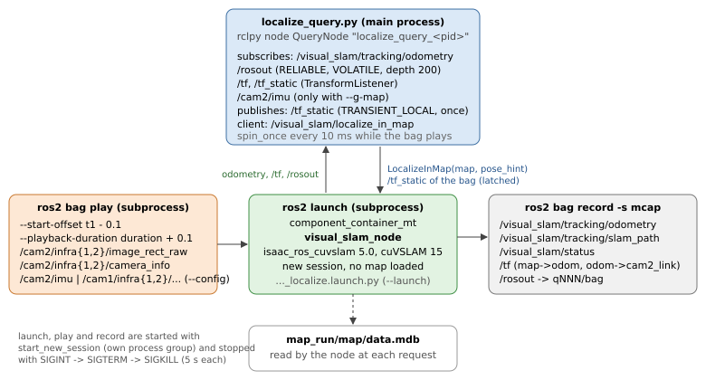
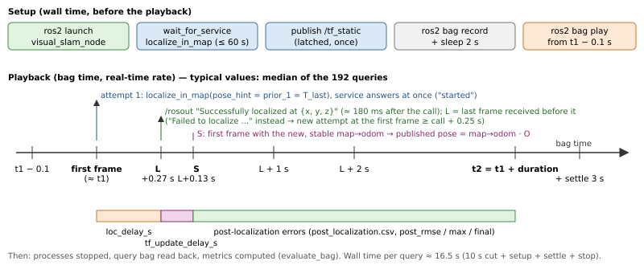
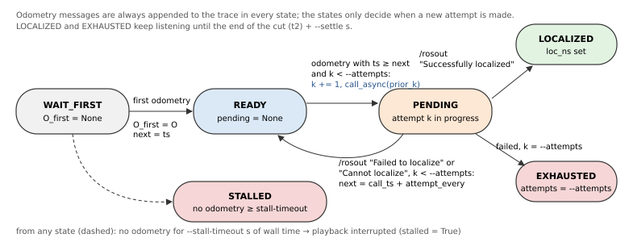
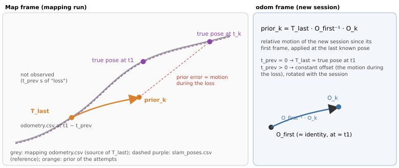
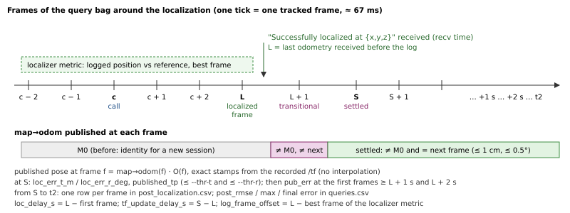

# The relocalization node of localize_query.py

Design and behavior of the ROS 2 node created by `VRHealth_Challenge13/isaac_ros_5/launch/localize_query.py`, which
measures how Isaac ROS cuVSLAM relocalizes a new session in a saved map after a simulated tracking loss.

Environment: desktop (RTX 4070 Ti), Docker image `cached_isaac_run_dev_image_local`, ROS 2 Lyrical,
`isaac_ros_cuvslam` 5.0.0, cuVSLAM 15.0.0+33da606. Configuration: cam2 IR stereo + IMU (`tracking_mode 1`), rectified
images, `base_frame cam2_link`. The numbers quoted as "typical" are medians over the 192 queries of the 11 captures in
`~/dotlumen/localization/isaac_localize/`.

## Contents

1. Purpose and context
2. Architecture
3. Interfaces
4. Per-query timeline
5. State machine of the node
6. The prior
7. Attempt scheduling
8. Reading the outcome from /rosout
9. How Isaac ROS and cuVSLAM implement localize_in_map
10. Evaluation from the recorded bag
11. Header stamps and receive times
12. Outputs
13. Runtime
14. Limitations and known issues
15. How to run, and --reevaluate

## 1. Purpose and context

A visual SLAM system that loses tracking (occlusion, darkness, fast motion, featureless walls) starts a new session with
its own odometry frame. To give positions in the known map again it has to **relocalize**: find where the new session
is in a map saved earlier. cuVSLAM does not do global place recognition: its localizer searches the map only **around a
prior** (pose hint), on a grid of candidate poses. A realistic prior after a loss is the last pose known before the loss
composed with the odometry of the new session since it started.

`localize_query.py` reproduces this situation with Isaac ROS 5.0, the ROS 2 wrapper of cuVSLAM 15 used on the Jetson,
on the recorded captures:

- a **mapping run** (`map_cam2.sh`) has already played the whole capture in real time and saved the map, the odometry
  (`odometry.csv`) and the final SLAM trajectory (`slam_poses.csv`);
- each **query** (t1, t_prev) simulates a loss that started t_prev seconds before t1: a brand-new `visual_slam_node`
  (no map) receives the cut [t1, t2 = t1 + duration] of the capture at real-time speed, and the node of
  `localize_query.py` asks it to localize in the saved map with the prior described above;
- the result is compared, frame by frame and without any alignment, with the reference trajectory of the mapping run,
  which lives in the same map frame.

The same experiment was previously done offline with PyCuVSLAM 17 (`scripts/map_bag.py localize`). Doing it in Isaac
ROS measures what the robot would actually get: the asynchronous localization of the ROS node, its timing in real time,
and the pose that Isaac ROS **publishes** after merging the session into the map, which turned out to differ often from
the localizer result.

## 2. Architecture

`localize_query.py` is one Python process that loops over the queries. For each query it starts three ROS 2
processes and one rclpy node, all inside the same Isaac ROS container:

| Process | Started as | Role |
|---|---|---|
| `visual_slam_node` | `ros2 launch cuvslam_stereo_imu_cam2_localize.launch.py` (`--launch`), in a `component_container_mt` | the system under test: a new cuVSLAM session with SLAM and localization enabled, no map loaded |
| `QueryNode` (rclpy, in the main process) | `QueryNode(...)`, node name `localize_query_<pid>` | listens to the session, computes the priors, calls `localize_in_map`, reads the result from `/rosout` |
| `/tf_static` republisher | a latched publisher of `QueryNode` | publishes the static transforms of the bag once (`TRANSIENT_LOCAL`) |
| bag recorder | `ros2 bag record -s mcap` | records the output of the session for the evaluation (`q<NNN>/bag`) |
| bag player | `ros2 bag play --start-offset t1 − 0.1 --playback-duration duration + 0.1` | feeds the cut of the capture at real-time speed |



Every child process is started with `start_new_session=True` (its own process group) and stopped at the end of the
query with SIGINT, then SIGTERM, then SIGKILL (5 s each) on the whole group, so that the component container and the
node inside it really exit before the next query starts. `QueryNode` is destroyed after each query and a new one is
created for the next; `rclpy.init()` / `shutdown()` are called once for the whole run.

The node is single-threaded: the main loop calls `rclpy.spin_once(node, timeout_sec=0.01)` while the player is
running, then for `--settle` s more. All the callbacks (odometry, logs, TF, IMU) therefore run in the main thread, in
order, and the attempt logic needs no locks.

The bag recorder makes the evaluation independent from the live callbacks: the live node only drives the attempts,
while all the localization metrics are computed afterwards from the recorded messages (section 10). This is also what
allows `--reevaluate`.

## 3. Interfaces

**Subscriptions of QueryNode**

| Topic | Type | QoS | Use |
|---|---|---|---|
| `/visual_slam/tracking/odometry` | `nav_msgs/Odometry` | depth 50 (default reliable, volatile) | one message per tracked frame: pose `O` of `cam2_link` in `odom`; drives the attempts; messages with stamp < t1 − 0.1 s are ignored |
| `/rosout` | `rcl_interfaces/Log` | depth 200, RELIABLE, VOLATILE | result of each attempt, from the messages of the logger `visual_slam_node` |
| `/tf`, `/tf_static` | `tf2_msgs/TFMessage` | `tf2_ros.TransformListener` (buffer of 120 s) | frames of the IMU for `--g-map` (`map->odom` helpers exist but are not used: the evaluation uses the bag) |
| `/cam2/imu` | `sensor_msgs/Imu` | depth 400 | only with `--g-map`: accelerometer samples (last 1000–2000 kept) |

**Publication**

| Topic | Type | QoS | Content |
|---|---|---|---|
| `/tf_static` | `tf2_msgs/TFMessage` | depth 1, RELIABLE, TRANSIENT_LOCAL | all the `/tf_static` transforms of the capture bag, read once at start-up and published once per query. The cut starts at t1, after the static messages at the start of the bag, so without this the node would not find `cam2_link` → optical frames and IMU frame |

**Service client**

| Service | Type | Request | Response |
|---|---|---|---|
| `/visual_slam/localize_in_map` | `isaac_ros_visual_slam_interfaces/srv/LocalizeInMap` | `map_folder_path` = absolute path of `<map-run>/map`; `pose_hint` = prior, pose of `base_frame` (`cam2_link`) in the map frame | `success`: only "the asynchronous localization was started" (not used) |

The client is created at node construction; `wait_for_service(60 s)` also serves as the check that the new
`visual_slam_node` is up. Calls are made with `call_async`, and the future is never awaited.

**Topics of the other processes**

| Process | Topics |
|---|---|
| player → node | `/cam2/infra1/image_rect_raw`, `/cam2/infra1/camera_info`, `/cam2/infra2/image_rect_raw`, `/cam2/infra2/camera_info`, `/cam2/imu` |
| node → recorder | `/visual_slam/tracking/odometry`, `/visual_slam/tracking/slam_path`, `/visual_slam/status`, `/tf` (`map->odom` and `odom->cam2_link` every frame, same stamp as the odometry), `/rosout` |

**Command-line arguments**

| Argument | Default | Effect on the node |
|---|---|---|
| `--bag`, `--map-run`, `--out-dir` | required | capture, map run (`map/`, `odometry.csv`, `slam_poses.csv`), output folder |
| `--launch` | `cuvslam_stereo_imu_cam2_localize.launch.py` | parameters of the session under test (search grid) |
| `--t1`, `--t1-step`, `--margin`, `--duration`, `--t-prev` | sampled, 5, 2, 10, `0 1 3 5` | which queries are run (section 4) |
| `--attempts`, `--attempt-every` | 16, 0.25 s | attempt scheduling (section 7) |
| `--settle` | 3 s | spinning after the end of the cut |
| `--thr-t`, `--thr-r` | 0.3 m, 10 deg | true positive thresholds of the evaluation |
| `--g-map`, `--imu-window` | off, 0.5 s | optional accelerometer roll/pitch correction of the prior |
| `--stall-timeout` | 10 s | stop a query after N s of wall time without odometry |
| `--reevaluate` | off | recompute the metrics from the recorded bags, no new query |

## 4. Per-query timeline

Queries: for every t1 (given with `--t1`, or every `--t1-step` s from `max(margin, start of the reference + max(t_prev)
+ margin)` to `end of the reference − duration`) and every t_prev, in this order. t1 is in seconds from the start of the
bag.



1. **Prior source.** `T_last` = last pose of the mapping `odometry.csv` with stamp ≤ `bag0 + t1 − t_prev` (bag0 = start
   of the bag in the header-stamp time base, section 11).
2. **Session.** `ros2 launch` of a new `visual_slam_node`; `QueryNode` is created with the odometry filter
   `ts_start = bag0 + t1 − 0.1 s`.
3. **Ready check.** `wait_for_service('/visual_slam/localize_in_map', 60 s)`; if it fails the query raises an error.
4. **Static frames.** Latched `/tf_static` of the bag.
5. **Recorder.** `ros2 bag record` of the output topics; 2 s wait so that it is subscribed before the first frame.
6. **Playback.** `ros2 bag play` from t1 − 0.1 s for duration + 0.1 s (the 0.1 s before t1 gives the IMU some samples
   before the first image).
7. **Spin** every 10 ms while the player runs. Callbacks drive the attempts (sections 5–8).
8. **Settle.** After the end of the playback, `--settle` s more of spinning (last odometry, a result still pending).
9. **Stop** player, recorder, launch (process groups).
10. **Evaluation** of the recorded bag (section 10) and rows of the output files.

Typical values: the session publishes its first odometry at t1 (the first frame of the cut, 15 Hz → frames every
~67 ms); the successful attempt answers about 180 ms after the call; the localized frame is 0.27 s after the first
frame; the published `map->odom` settles 0.13 s after the localized frame.

## 5. State machine of the node



The state is held in a few fields:

| Field | Meaning |
|---|---|
| `odom` | list of `(stamp, O)` of every odometry message ≥ `ts_start`, in arrival order |
| `O_first` | pose of the first odometry message (None before it) |
| `pending` | the attempt in progress (dict with number, call stamp, prior, wall start time, `gravity_used`), or None |
| `attempts` | finished attempts (each with `ok`, message, latency, frame stamp at the result) |
| `next_attempt_ns` | earliest frame stamp for the next call |
| `loc_ns` | stamp of the last frame received when the success log arrived (None until then) |

Transitions:

| From | Event | Action | To |
|---|---|---|---|
| WAIT_FIRST | first odometry message | `O_first = O`, `next_attempt_ns = stamp` | READY (and the same message starts attempt 1) |
| READY | odometry with stamp ≥ `next_attempt_ns` and fewer than `--attempts` attempts | prior from this frame, `call_async`, `pending` set | PENDING |
| PENDING | odometry | appended to `odom`, no new attempt | PENDING |
| PENDING | `/rosout` of `visual_slam_node` starting with `Successfully localized` | attempt finished with `ok`, `loc_ns` = last frame received | LOCALIZED |
| PENDING | `/rosout` starting with `Failed to localize in map` or `Cannot localize` | attempt finished, `next_attempt_ns = call stamp + attempt_every` | READY (or EXHAUSTED when `--attempts` is reached) |
| any | no odometry for `--stall-timeout` s (wall time; counted from the start of the playback before the first message) | playback loop left, `stalled = True` | STALLED |
| any | end of the playback + `--settle` | processes stopped | end |

LOCALIZED and EXHAUSTED make no more calls but keep receiving odometry until the end of the cut, so the trace and the
recorded bag cover the whole cut [t1, t2] in every case.

## 6. The prior

The prior of attempt k, made at the frame with odometry `O_k`, is

```
prior_k = T_last · O_first⁻¹ · O_k
```

All terms are 4×4 rigid transforms of the base frame `cam2_link`:

- `T_last` (map ← cam2_link at t1 − t_prev): the last pose known before the loss, from the odometry of the mapping run.
  The odometry of the mapping run is in the `odom` frame of that run; its `map` frame (in which the map was saved and
  `slam_poses.csv` is expressed) starts identical to it at the first pose, and the odometry drifts away from it as the
  run goes on (loop closures correct only the SLAM poses). The odometry is used rather than the SLAM poses because it is
  what the system knows at that moment, without later corrections; its drift is part of the prior error.
- `O_first` (odom' ← cam2_link at the first frame of the new session) and `O_k` (odom' ← cam2_link at the frame of
  attempt k): odometry of the new session, in its own `odom'` frame. `O_first` is normally the identity, but the formula
  does not rely on it.
- `O_first⁻¹ · O_k` is the motion of the rig since the new session started, expressed in the rig frame at the first
  frame; left-multiplying by `T_last` places that motion at the last known pose.



Consequences:

- With t_prev = 0, `T_last` is (close to) the true pose at t1, and the prior follows the true trajectory with the drift
  of the new session only; its error at the first frame is the odometry-vs-SLAM difference of the mapping run plus the
  time between the two poses (median 0.08 m / 1.0°).
- With t_prev > 0 the rig moved during the loss without being observed, so the prior has a **constant offset** equal to
  that unobserved motion, rotated by the new session as it turns. Median prior error: 0.86 m / 5.3° at t_prev = 1 s,
  2.0 m / 12.9° at 3 s, 3.3 m / 16.7° at 5 s.
- The prior is also wrong in rotation by the heading change during the loss, which matters because the search grid is
  defined around the prior (radius 4 m horizontally, 1 m vertically, full 360° in heading, but no roll/pitch search).

**Optional gravity correction (`--g-map`)**: when the gravity direction in the map frame is given, the roll and pitch of
the prior are replaced by those given by the accelerometer: the mean of the last `--imu-window` s of `/cam2/imu`
(rotated to `cam2_link` with `/tf_static`) is taken as −gravity, and the minimal rotation that aligns it with `--g-map` is
applied to the prior rotation (position and heading unchanged). It needs at least 5 IMU samples in the window; the
attempt records `gravity_used`. Isaac ROS does not publish a gravity estimate in the map frame, so this option was not
used for the results.

**Worked example 1** (loop_closure, query 4: t1 = 6.971 s, t_prev = 5 s, first attempt)

- `T_last` = the `odometry.csv` pose 5.0 s before the first frame of the session; at the first frame `O_k = O_first`,
  so `prior_1 = T_last`.
- The node logs `Trying to localize in map ... around [0.197, 0.040, -0.028]`: the position of the prior.
- Prior error vs the reference at the first frame: **2.87 m / 22.4°** (the motion during the 5 s of "loss").
- 248 ms later: `Successfully localized at {3.074, 0.213, 0.082}`; that position is 0.017 m from the reference at the
  closest frame (localizer TP).
- The localized frame is 0.267 s after the first frame; `map->odom` settles 0.2 s later; the published pose there is
  0.052 m / 0.91° from the reference (published TP), 0.035 m after 1 s, 0.17 m after 2 s, and 1.69 m at the end of the
  10 s cut (drift after the merge).

**Worked example 2** (pedestrians_105, query 8: t1 = 12.604 s, t_prev = 5 s, three attempts)

`T_last` = (1.126, 0.068, 0.584) m, yaw −0.3°. The new session's odometry starts at the identity. The rig walks and
turns right:

| Attempt | Time from t1 | `O_k` position (m), yaw | prior_k position (m), yaw | reference position (m), yaw | prior error | Result (latency) |
|---|---|---|---|---|---|---|
| 1 | 0.000 s | (0, 0, 0), 0° | (1.126, 0.068, 0.584), −0.3° | (6.737, −0.184, 3.158), −17.3° | 6.18 m | failed (1561 ms) |
| 2 | 1.601 s | (1.850, −0.086, 0.365), −20.6° | (2.844, −0.043, 1.358), −21.9° | (8.388, −0.839, 4.022), −39.6° | 6.20 m | failed (1399 ms) |
| 3 | 3.001 s | (3.287, −0.628, 0.664), −40.0° | (4.177, −0.604, 1.953), −41.4° | (9.594, −1.831, 4.479), −58.6° | 6.10 m | success (1656 ms) |

- The prior follows the shape of the true motion (the yaw changes by the same ~20° per attempt), but stays about 6 m and
  17° behind: the offset accumulated during the 5 s of loss.
- Attempts 2 and 3 are not 0.25 s apart but 1.4–1.6 s: a new call waits for the failure of the previous one (section
  7).
- Attempt 3 logs `Successfully localized at {10.286, -3.422, 4.670}`, which is 0.04 m from the reference at the closest
  frame (localizer TP), but the pose published by Isaac ROS at the settled frame is **3.91 m / 10.8°** off (published FP),
  and still 3.5 m off 2 s later: a case of the localizer/published mismatch of section 9.

## 7. Attempt scheduling

- **First attempt** at the first odometry message of the session (stamp ≥ t1 − 0.1 s). Waiting for odometry guarantees
  that the cuVSLAM tracker is initialized: before the first frame the service answers `success = false` with "CUVSLAM
  tracker is not initialized", a message the node would not recognize.
- **One attempt at a time**: while an attempt is pending no other call is made, because a new request would replace the
  running asynchronous localization in Isaac ROS (it joins the previous localization thread and starts a new one).
- **After a failure** the next call is made at the first frame with stamp ≥ call stamp + `--attempt-every` (bag time).
  Since a failure is reported only after the localizer has tried its whole grid (1.4–1.6 s in the examples), the
  effective spacing of the attempts is the failure latency, not 0.25 s; `--attempt-every` matters only for fast
  failures.
- **Up to `--attempts`** calls; in a 10 s cut at most about 6 slow failures fit, so the limit of 16 is never reached in
  practice.
- **After a success** no more calls: the session is in the map.
- Each attempt computes its prior from the frame at which it is made (the latest odometry), not from the frame the
  localizer will actually use, which is a few frames later.

Observed: 191 of 192 queries localized; 188 at the first attempt; only 3 needed 2–3 attempts; one query (pedestrians_105,
t_prev = 5 s) failed every attempt until t2.

## 8. Reading the outcome from /rosout

The service cannot be used to know the result:

- `CallbackLocalizeInMap` of Isaac ROS stores the request, starts a thread that calls `LocalizeInMapAsync` and returns
  `success = true` at once: it only means "started";
- the localization is then completed **during the normal tracking** of the following frames, and its result is
  published only as log messages of `visual_slam_node`.

So the node subscribes to `/rosout` and considers only messages whose logger name is `visual_slam_node`:

| Message (prefix) | Meaning | Node action |
|---|---|---|
| `Starting async localization in map '...'` | request received | ignored live; used by the evaluation as the call time |
| `Trying to localize in map '...' around [x, y, z]` | prior position, in the map frame | ignored |
| `Async localization started, waiting for callback during normal tracking` | localizer queued | ignored |
| `Successfully localized at {x, y, z}` | localizer solution: position of `cam2_link` in the map frame (no rotation) | success |
| `Failed to localize in map. Error ...` | localizer gave up | failure |
| `Cannot localize in map because ...` | request refused (e.g. `enable_localization_n_mapping` false, node exiting) | failure |
| `Localization completed successfully` / `Localization failed` | final status check | ignored |

The latency stored for the attempt is the wall time between `call_async` and the arrival of the result message; the
frame stored is the last odometry received at that moment. `/rosout` is subscribed with a reliable, volatile QoS of depth
200 before the first call, so no result message can be missed; the "Starting/Trying" messages arrive within a
millisecond of the call.

Example (`loop_closure/q001/node_log.txt`, receive times in ns):

```
1794599191462191135 Starting async localization in map '/workspaces/isaac_ros-dev/localization/isaac_maps/loop_closure/map'
1794599191462288758 Trying to localize in map '...' around [3.060297, 0.215559, 0.074012]
1794599191467422262 Async localization started, waiting for callback during normal tracking
1794599191579101010 Successfully localized at {3.056898, 0.204764, 0.124286}
1794599191710976554 Localization completed successfully
```

## 9. How Isaac ROS and cuVSLAM implement localize_in_map

Sources: Isaac ROS `isaac_ros_visual_slam` (release 4.4 source; its log messages are identical to those of the 5.0
binary in the image) and cuVSLAM at commit 33da606 (the version used by Isaac ROS 5.0).

**ROS side (`visual_slam_node`)**

1. `pose_hint` is the pose of `base_frame` in `map_frame`; the node converts it to cuVSLAM conventions
   (`ChangeBasis(canonical_pose_cuvslam, ...)`).
2. It checks that the map folder exists and contains `.mdb` files, then calls `Slam::LocalizeInMap(folder, hint,
   images = {}, settings, callback)` with **no images** and the search grid of the parameters
   `localizer_horizontal_radius`, `localizer_vertical_radius`, `localizer_horizontal_step`, `localizer_vertical_step`,
   `localizer_angular_step` (4 m, 1 m, 0.5 m, 0.25 m, 10° in the localize launch file).
3. In the next `Track()` calls the asynchronous localizer receives the images of the new frames and tries the grid
   candidates around the hint (horizontal on the rig x/z plane, vertical along rig y, 360° around the vertical axis,
   closest candidates first) until one is solved or the grid is exhausted.
4. The callback converts the result back to ROS (`map_pose_base_link`) and logs `Successfully localized at {x, y, z}`
   (position only), or logs `Failed to localize in map. Error ...`.

**cuVSLAM side: what happens to the session after a success**

1. The localizer returns `pose_in_slam` (pose of the rig in the loaded map), the frame/keyframe of the session it refers
   to, and the keyframe of the map it was matched to. `pose_in_slam` is the pose that Isaac ROS logs.
2. The result is queued to the SLAM thread as a command (`UnionAfterLocalizationCmd`), executed some frames later.
3. `LocalizerAndMapper::UnionWith(...)` merges the session into the map: keyframes and landmarks are re-indexed, the
   pose graph of the session is united with the pose graph of the map with **one edge** between the session keyframe
   and the map keyframe, the pose graph is optimized (`max_iterations = 10`, first node fixed), the current pose is moved
   by the resulting correction, landmark indexes are merged, keyframes reduced.
4. The poses of the frames after the last keyframe (the "tail") are corrected with `updated = p · (old⁻¹ · new)`.
5. From then on the SLAM pose is in the map frame. At every frame Isaac ROS publishes
   `map->odom = map_pose_base_link · odom_pose_base_link⁻¹` on `/tf`, with the stamp of the odometry. Before the
   localization, in a new session, `map` and `odom` coincide (identity).

**Consequences for the measurement**

- The **logged position** is the localizer's answer for one frame; the **published pose** is the SLAM state after the
  merge and a 10-iteration optimization with a single constraint. They coincide only when that optimization puts the
  head of the session on the localized pose. In 31 of the 121 queries with a correct logged position the published pose
  was 0.3–10.9 m off (median 1.95 m).
- `map->odom` does not jump at the localized frame: the merge runs in the SLAM thread, so the new `map->odom` appears
  some frames later, often after 1–2 **transitional** values (median 0.13 s after the localized frame).
- The library in the image is built without `USE_SLAM_OUTPUT`, so merge, optimization and loop closure events are not
  logged (cuVSLAM `verbosity: 3` only adds "Lost IMU msgs" warnings), and `/visual_slam/status` does not report them.

Both results are therefore measured: the localizer metric (logged position) and the published metric (pose published at
the first settled `map->odom`).

## 10. Evaluation from the recorded bag

`evaluate_bag(q<NNN>, reference)` reads the query bag back and computes the metrics. It uses the bag rather than the live
callbacks because the bag has exact receive times for all topics and the exact `map->odom` of every frame (no TF
interpolation, no buffer timing issues), and because it can be rerun (`--reevaluate`).



**Inputs from the bag**

- odometry: `(header stamp, receive time, O)` for every frame;
- `map->odom` from `/tf`, indexed by stamp (same stamp as the odometry of the frame);
- `/rosout` messages of `visual_slam_node` with their receive times.

It first writes `trace.csv` (odometry and published pose `map->odom · O` per frame) and `node_log.txt`. If there is no
`Successfully localized` message the query has no localization metrics.

**Localized frame (L)**: the last odometry message received **before** the success log. `loc_ts_ns` = its stamp,
`loc_delay_s` = L − first frame of the session.

**Localizer metric** (`loc_log_err_t_m`, `localizer_tp`): the logged position is compared with the reference at every
frame from 2 frames before the call (the frame received at or after the last `Starting async localization` message)
up to L, and the smallest distance is kept; `log_frame_offset` is how many frames before L the best frame is. The node
does not publish which frame the localizer solved, so this is optimistic by at most the motion within that window.
Observed `log_frame_offset`: 0–3 frames (≤ 0.2 s) in 145 of the 191 localized queries, up to 36 frames when the
localizer took long (the window grows with the latency). TP if the distance ≤ `--thr-t`. Translation only: the log has no rotation.

**Settled frame (S)**: with `M0` = `map->odom` at L, the frames after L are scanned; frames whose `map->odom` is still
equal to `M0` are skipped; the first frame whose `map->odom` differs from `M0` **and** is equal to the one of the next
frame is the settled frame ("equal" = within 1 cm and 0.5°). A transitional value, different from both its predecessor
and its successor, is therefore skipped. `tf_update_delay_s` = S − L. If no settled frame is found, only the localizer
metric is reported.

**Published metric** (`loc_err_t_m`, `loc_err_r_deg`, `published_tp`): error of `map->odom(S) · O(S)` against the
reference pose with the same stamp (tolerance 2 ms); TP if ≤ `--thr-t` and ≤ `--thr-r`.

**Errors later**: `pub_err_*_1s` and `pub_err_*_2s` = published error at the first frames at least 1 s and 2 s after L;
every frame from S to t2 is written to `post_localization.csv`, and `post_frames`, `post_rmse_t_m`, `post_max_err_t_m`,
`post_final_err_t_m`, `post_final_err_r_deg` summarize them.

Errors: translation = Euclidean distance of the positions; rotation = angle of `R_ref⁻¹ · R`; both in the map frame,
without alignment. The reference is `slam_poses.csv` of the mapping run (the same run that saved the map).

**Prior errors** (queries.csv, attempts.csv) are computed live: `T_last` against the reference at the first frame, and
each `prior_k` against the reference at the call frame.

## 11. Header stamps and receive times

Two time bases are involved:

- **bag (receive) time**: `--start-offset` of `ros2 bag play` and the t1 of the queries are seconds from the start of the
  bag, as recorded;
- **header stamps**: the poses of `odometry.csv` and `slam_poses.csv`, and the odometry of the new session, carry the
  header stamps of the images.

For the original captures the two differ only by the transport latency (milliseconds). For the "converted" captures
(staircases_fix_1, build_in_out, build_out_in, outdoor_b_2000) the receive times were rewritten and the header stamps
are 17–25 days earlier. The node measures the offset as the median of (receive time − header stamp) over the first 50
images of `/cam2/infra1/image_rect_raw` (header stamp decoded directly from the CDR bytes) and uses
`bag0 = bag start − offset`, the bag start in the header-stamp base. Then:

- `T_last` is looked up at `bag0 + t1 − t_prev` in header stamps;
- the odometry filter is `bag0 + t1 − 0.1 s`;
- the sampling of t1 uses `(reference stamp − bag0)`;
- t1 itself stays in bag time, so `--start-offset t1 − 0.1` plays the right cut.

When the offset exceeds 1 s the script prints `header stamps N s before the receive times: t1 kept in bag time`.

The receive times stored in the query bag (recorder clock) are used only to order the log messages with respect to the
odometry messages in the evaluation.

## 12. Outputs

In `--out-dir`:

| File | Content |
|---|---|
| `queries.csv` | one row per query (columns below) |
| `attempts.csv` | `query, attempt, call_ts_ns, frame_ts_ns, t_from_t1_s, prior_err_t_m, prior_err_r_deg, gravity_used, ok, latency_ms, message` |
| `post_localization.csv` | `query, timestamp_ns, t_from_loc_s, x, y, z, qx, qy, qz, qw, err_t_m, err_r_deg`: published pose from S to t2 and its error |
| `localize_info.json` | bag, map run, launch, t1 list, t_prev, duration, attempts, `attempt_every_s`, thresholds, `g_map`, `imu_window_s`, `stall_timeout_s` |
| `q<NNN>/bag/` | MCAP recording of the query |
| `q<NNN>/trace.csv` | `timestamp_ns, recv_ns, odom_x, odom_y, odom_z, odom_qx, odom_qy, odom_qz, odom_qw, pub_x … pub_qw` (pub empty without `map->odom` at that stamp) |
| `q<NNN>/node_log.txt` | `<recv ns> <message>` of `visual_slam_node` |
| `q<NNN>/launch.log`, `record.log`, `play.log` | process logs |

Columns of `queries.csv`:

| Column | Meaning |
|---|---|
| `query`, `t1_s`, `t_prev_s`, `t2_s` | query number and cut |
| `t1_ts_ns` | stamp of the first odometry of the session |
| `prior_ts_ns`, `prior_gap_s` | stamp of `T_last`, first frame − `T_last` (≈ t_prev, more if the first frame came late) |
| `prior_err_t_m`, `prior_err_r_deg` | `T_last` vs reference at the first frame |
| `localized`, `attempt_ok`, `attempts` | success (live), successful attempt, attempts made |
| `loc_ts_ns`, `loc_delay_s` | localized frame L and L − first frame |
| `loc_err_t_m`, `loc_err_r_deg`, `published_tp` | published metric at S |
| `loc_log_err_t_m`, `log_frame_offset`, `localizer_tp` | localizer metric |
| `tf_update_delay_s` | S − L |
| `pub_err_t_m_1s`, `pub_err_r_deg_1s`, `pub_err_t_m_2s`, `pub_err_r_deg_2s` | published error ≥ 1 s and ≥ 2 s after L |
| `first_attempt_latency_ms`, `ok_attempt_latency_ms` | call → result, wall time |
| `post_frames`, `post_rmse_t_m`, `post_max_err_t_m`, `post_final_err_t_m`, `post_final_err_r_deg` | errors from S to t2 |
| `frames_tracked`, `query_wall_s`, `stalled` | odometry messages, wall time, stopped for lack of odometry |

Standard output: one line per query, e.g.
`query 4: t1=6.971 t_prev=5.0 -> localized at attempt 1, log 0.0166 m, published 0.0515 m / 0.91 deg`.

## 13. Runtime

| Phase | Typical wall time |
|---|---|
| launch + service available | ~1 s |
| recorder start | 2 s |
| playback | duration + 0.1 s (10.1 s) |
| settle | 3 s |
| stop of the three process groups, evaluation | < 1 s |
| **per query** | **16.5 s** median (11.1–17.5 s; 5 s cuts on outdoor_b_2000) |

192 queries of 11 captures took about 52 minutes of wall time (loop_closure: 36 queries, about 10 minutes). Latency of
the successful attempt: median 183 ms (medians per capture and t_prev between 74 and 543 ms); failed attempts
1.4–1.6 s. Recorded data: 1–4 MB per query bag.

## 14. Limitations and known issues

**Of the measurement**

- **Real time, not repeatable**: every query is one real-time run; the same query can give different published results
  in different runs (loop_closure, t1 = 26.97 s / t_prev = 1 s: 2.44, 1.01 and 0.05 m). Single cases need repetitions.
- **Optimistic setting**: the query capture is the map capture, so the localizer sees the same images that built the
  map; the results are an upper bound of a new visit.
- **Reference**: the SLAM trajectory of the mapping run, not ground truth. Unreliable in the elevators (the cabin moves
  with the user) and wrong on staircases_fix_1 (every stereo + IMU run of Isaac ROS 5.0 diverges there).
- **Localizer metric**: optimistic by the motion within the call→log window, since the solved frame is not known; no
  rotation.
- **Desktop timings**: latencies and delays are RTX 4070 Ti values, not Jetson ones.

**Of the implementation**

- A **pending attempt has no timeout**: if `visual_slam_node` never logs one of the recognized messages (e.g. it crashes,
  or answers with an unrecognized error), no further attempt is made and the pending attempt is not written to
  `attempts.csv`. Only the stall timeout (no odometry) stops a query early.
- The **frame of the live result** (`frame_ts_ns`, `loc_ns`) is the last odometry received when the log arrives in the
  node; the evaluation recomputes L from the recorded receive times, and `queries.csv` uses the latter.
- The node name `localize_query_<pid>` is the same for every query of a run: rclpy prints "Publisher already registered
  for node name ..." for the rosout publisher. Harmless (each node is destroyed before the next is created).
- `--reevaluate` rewrites `localize_info.json` with the **current** arguments (e.g. `--t-prev`, thresholds): pass the
  same options as the original run. It also needs `--bag` and `--map-run` and a ROS environment (`rosbag2_py`).
- `QueryNode.map_odom` / `map_pose` (live TF lookups) are not used anymore; the columns `loc_err_vert_m` and
  `within_threshold` handled by `--reevaluate` are never written (no gravity in the map frame).
- `--g-map` was not used for the results; it needs a gravity direction in the map frame, which Isaac ROS does not
  provide, and enough IMU samples in the window.
- All the queries of a run share one ROS domain: two runs of `localize_query.py` must not run at the same time in the
  same domain (they would see each other's `visual_slam_node`).
- The docstring of `cuvslam_stereo_imu_cam2_localize.launch.py` mentions verbosity 3, but the file sets `verbosity: 1`.

## 15. How to run, and --reevaluate

From the host (the data folder `~/dotlumen` is mounted at `/workspaces/isaac_ros-dev`, paths relative to it):

```bash
docker run --rm --gpus all --ipc=host --user $(id -u):$(id -g) -e HOME=/tmp -e ROS_LOG_DIR=/tmp/roslog \
  -v ~/dotlumen:/workspaces/isaac_ros-dev -w /workspaces/isaac_ros-dev cached_isaac_run_dev_image_local \
  bash -c 'source /opt/ros/lyrical/setup.bash; python3 VRHealth_Challenge13/isaac_ros_5/launch/localize_query.py \
   --bag Captures/mcap/9_Loop_closure/loop_closure --map-run localization/isaac_maps/loop_closure \
   --out-dir localization/isaac_localize/loop_closure'
```

- `--user`, `HOME=/tmp`, `ROS_LOG_DIR=/tmp/roslog`: files are written with the host user, ROS logs go to a writable
  place.
- `--ipc=host`: shared memory for the ROS 2 transport between player, node and recorder.
- The map must exist (`map_cam2.sh`) and `--map-run` must point to the folder with `map/`, `odometry.csv` and
  `slam_poses.csv`.
- Short test: add `--t1 20 35 --t-prev 0 3` (4 queries) and another `--out-dir`.
- Short captures: `--duration 5` (outdoor_b_2000).

**Recompute the metrics without running the queries again**

```bash
docker run --rm --gpus all --ipc=host --user $(id -u):$(id -g) -e HOME=/tmp -e ROS_LOG_DIR=/tmp/roslog \
  -v ~/dotlumen:/workspaces/isaac_ros-dev -w /workspaces/isaac_ros-dev cached_isaac_run_dev_image_local \
  bash -c 'source /opt/ros/lyrical/setup.bash; python3 VRHealth_Challenge13/isaac_ros_5/launch/localize_query.py \
   --bag Captures/mcap/9_Loop_closure/loop_closure --map-run localization/isaac_maps/loop_closure \
   --out-dir localization/isaac_localize/loop_closure --reevaluate'
```

`--reevaluate` reads `queries.csv` and `attempts.csv`, removes the localization columns of every row, runs
`evaluate_bag` again on `q<NNN>/bag` of every localized query (rewriting `trace.csv` and `node_log.txt`), and writes
`queries.csv`, `attempts.csv` (unchanged), `post_localization.csv` and `localize_info.json` again. The live columns (prior,
attempts, latencies, wall time) are kept. It is the way to apply a change of the evaluation rules or of the thresholds
(`--thr-t`, `--thr-r`) to existing results. A GPU is not needed for it, but the Isaac ROS image is (rosbag2_py and the
message types).

After the queries, the results are visualized with `scripts/isaac_localize_rerun.py` and summarized with
`scripts/isaac_localize_summary.py` (see `isaac_scripts_documentation.md`).
